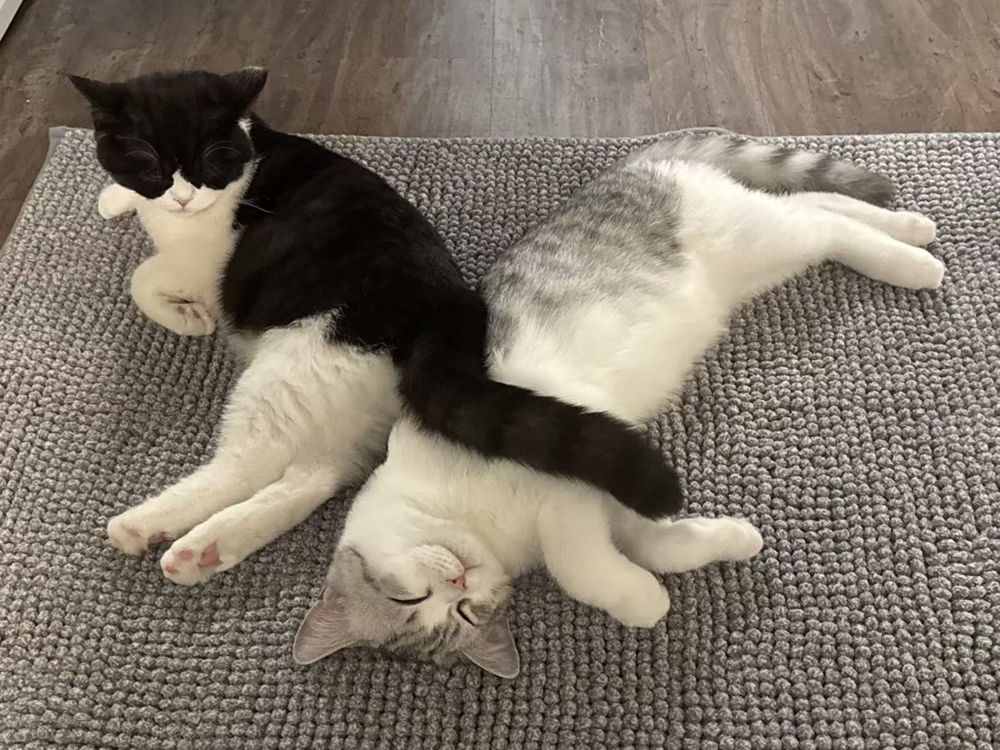
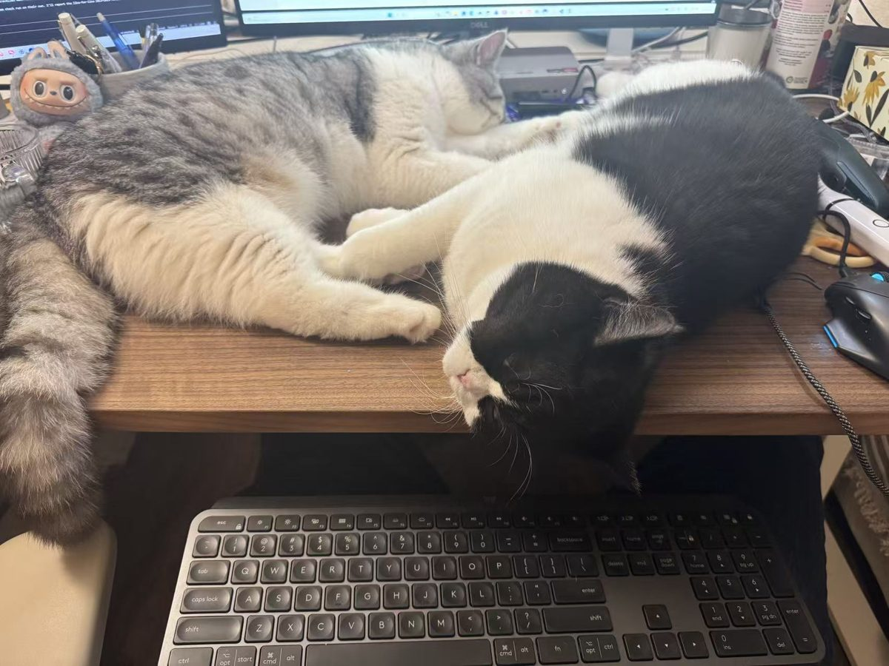
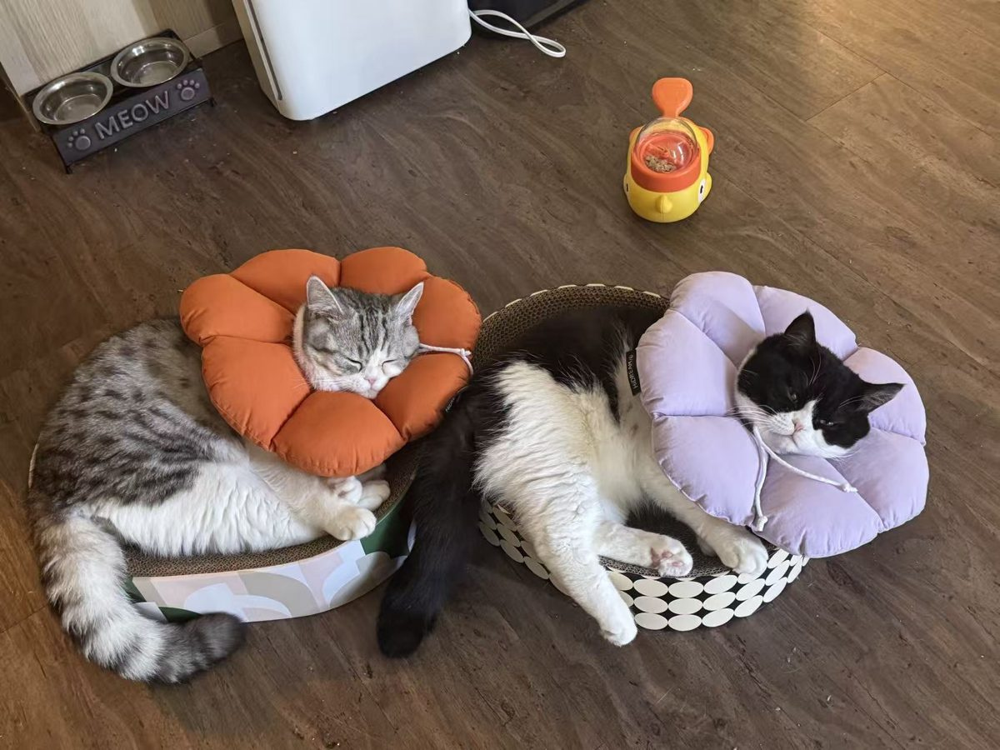
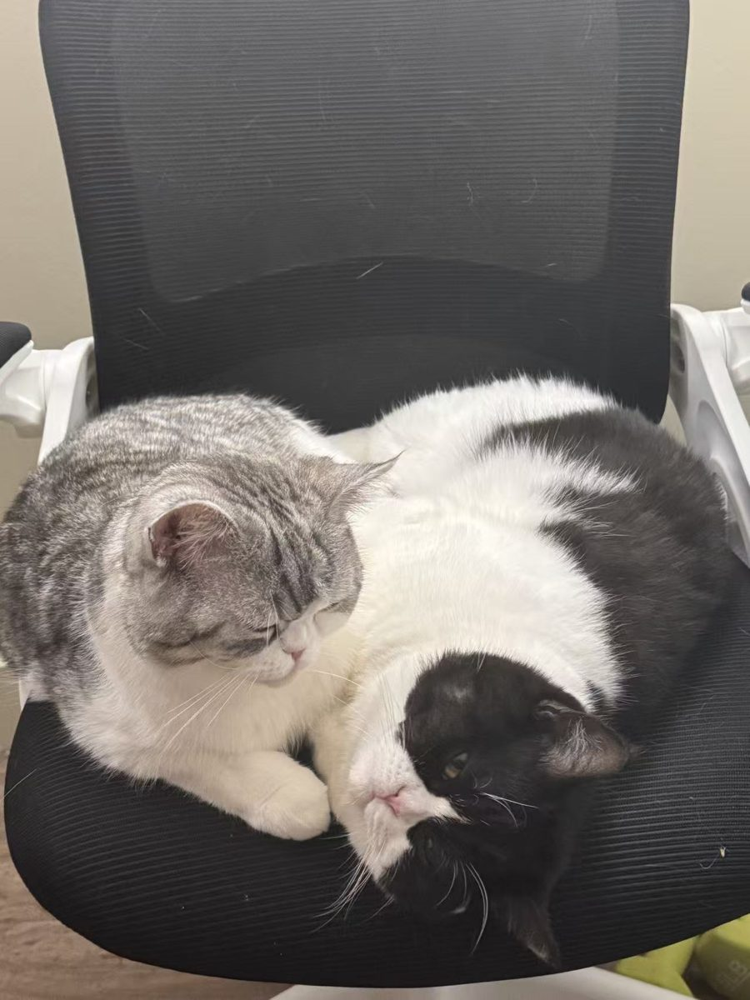
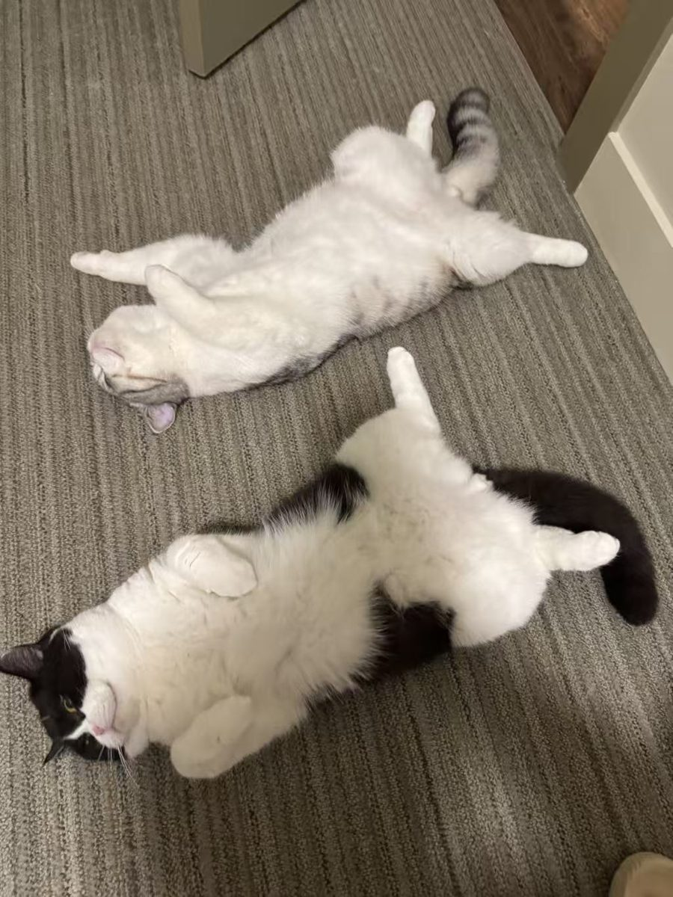
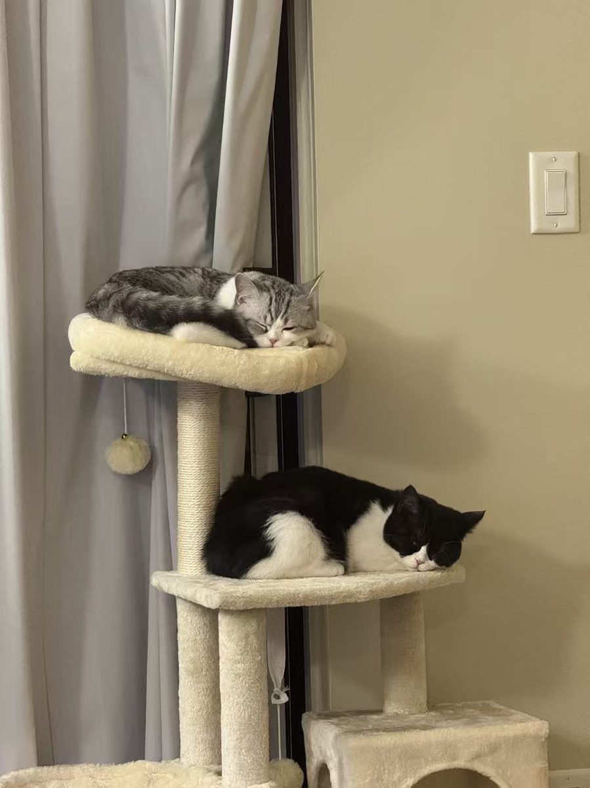
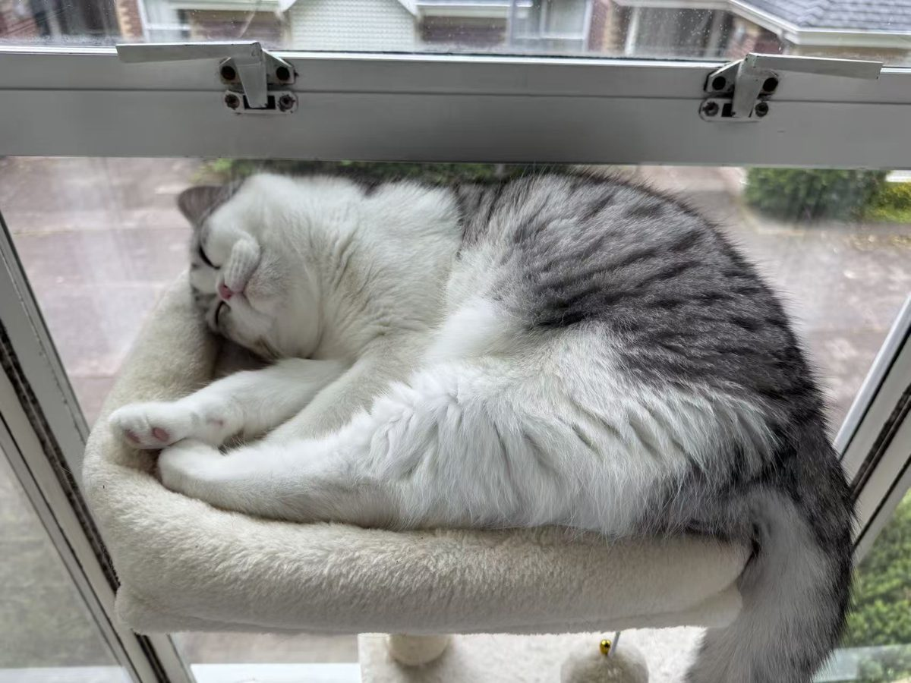
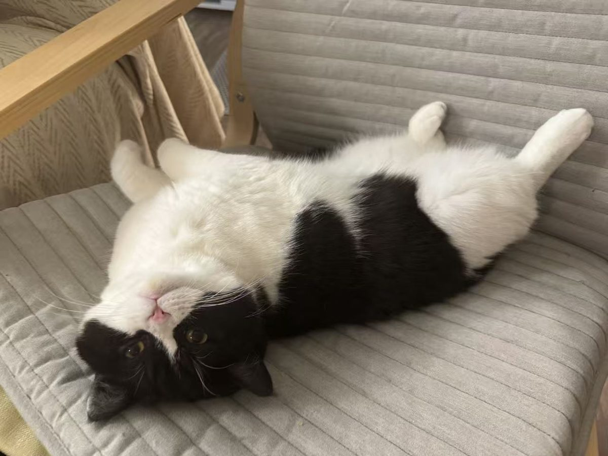
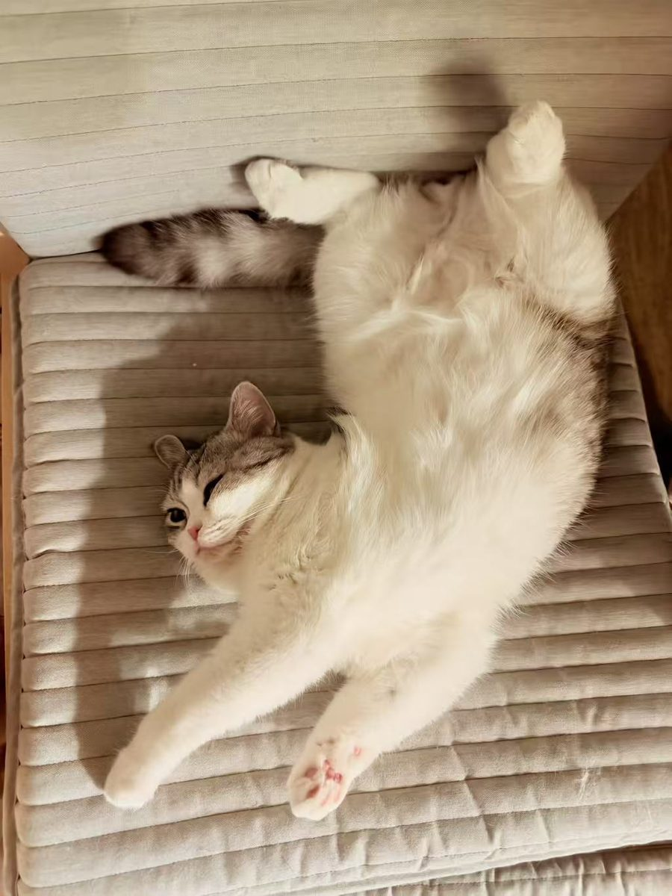

I am a PhD student in Finance at the UBC Sauder School of Business. My research is in asset pricing, both empirical and theoretical, with a focus on the links between financial markets and the macroeconomy, and I use modern machine-learning methods in my research. Before the PhD, I completed an M.Sc. in Finance at UBC Sauder, worked as a quantitative researcher on high-frequency and alpha strategies in the Chinese stock market, and earned a B.Econ. from the University of Science and Technology of China (USTC). [CV](/cv/)

Research
======

**The Wisdom of the Crowd or the Wisdom of Insiders? Insider Trading on Prediction Markets**  
[SSRN](https://papers.ssrn.com/sol3/papers.cfm?abstract_id=6678718)

Trackers
======

- [**Finance JMP Tracker**](https://lsy617004926.github.io/finance-jmp-tracker/): what data finance job market papers use and which topics they cover.
- [**Finance Paper Tracker**](https://lsy617004926.github.io/finance-paper-tracker/): every research paper in the top three finance journals since 2000, with links to replication packages and online appendices.
- [**Economics Paper Tracker**](https://lsy617004926.github.io/economics-paper-tracker/): every research paper in the top five economics journals since 2000, with links to replication packages and online appendices.

Public Goods
======

I keep a list of lecture notes and courses, mostly PhD-level, in finance, economics and computer science that have helped me: [Public Goods](/public-goods/). All credit goes to the original authors.

Cats
======

My two cats, Lemon and Peach.

  
  
  
  
  
  
  
  
  
  
  

